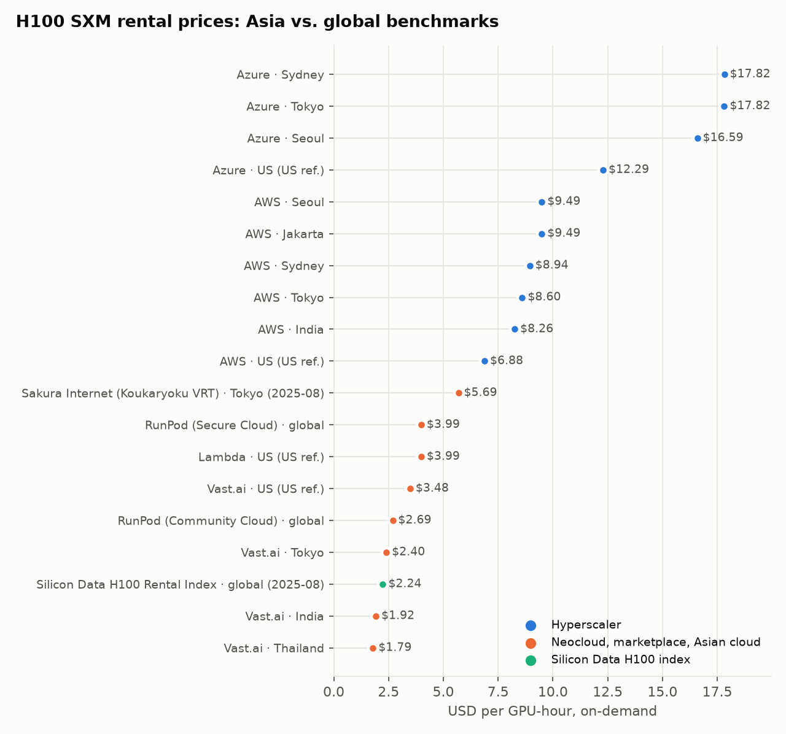
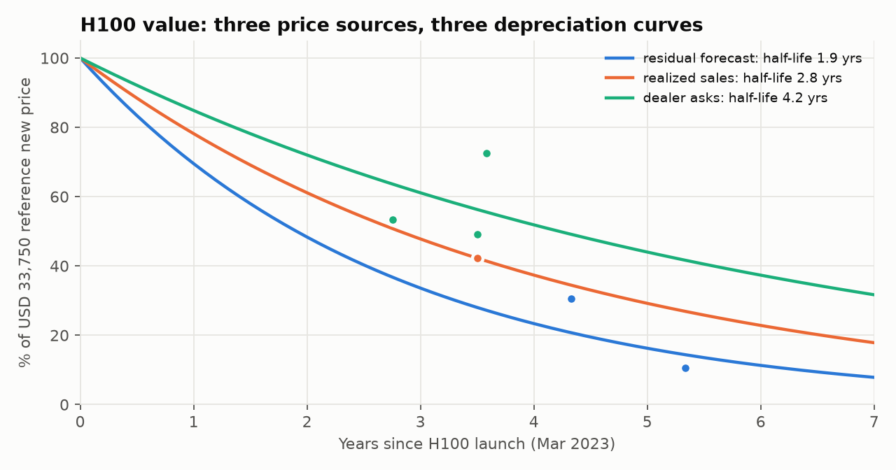
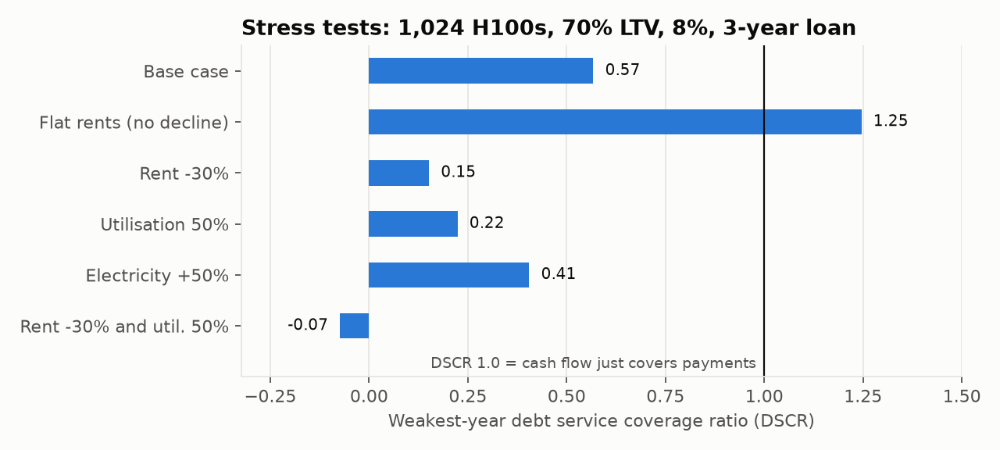
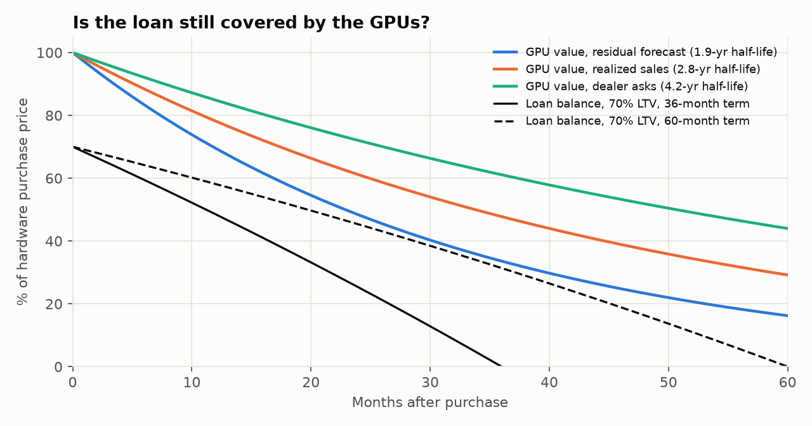

# Asia GPU Economics

**A mini Silicon Data for Asia: who charges what for an H100, how fast the hardware loses value, and whether a debt-financed GPU cluster in Asia pays its loan.**

[English](#english) · [中文](#中文)



---

## English

### 1. GPU compute is becoming a financial asset

Two years ago, renting an NVIDIA H100 was a supply-shortage negotiation. Today it trades more like a commodity:

- **Prices collapsed, then settled.** On-demand H100 rates went above $8 per GPU-hour in the 2023 shortage. By mid-2025 the Silicon Data H100 Rental Index was around $2.22–2.36.
- **It got a benchmark.** In May 2025 Silicon Data launched the first daily GPU rental index, published on Bloomberg as `SDH100RT`. It now covers H100, H200, A100, B200, B300 and MI300X, with separate neocloud and hyperscaler readings for H100 and A100.
- **It's getting a derivatives market.** In May 2026 CME Group and Silicon Data announced compute futures on the H100 and B200 rental indices, planned for 5 October 2026 subject to regulatory approval.
- **It's financed like real estate.** GPU clusters are bought with debt secured on the GPUs. Lenders need what any asset-backed lender needs: a market price, a depreciation curve, and a cash-flow model that survives stress.

### 2. What Silicon Data solves, and the gap in Asia

Silicon Data turns millions of scattered quotes into one standardised number, USD per GPU-hour. That number is what makes hedging, lending and futures possible.

Its public index is a **global** benchmark, and its product pages show no regional breakdown. Asian prices don't behave like the global average. This repo collected 42 quotes on 19 October 2026:

| What the data shows | Why it matters |
|---|---|
| Asian hyperscaler H100 median: **$9.49**/GPU-hr (range $8.26–17.82). Asian neocloud and marketplace median: **$2.16**. A **4.4×** gap. | A global index says little about what an Asian buyer actually pays |
| The same AWS or Azure instance costs **1.20–1.45×** more in Tokyo, Seoul, Mumbai, Jakarta or Sydney than in US East | Asia carries a regional premium even inside one provider |
| Neither AWS nor Azure lists on-demand H100 capacity in its **Hong Kong** region | A financial hub with no public hyperscaler H100 price |
| Only **4** Asian non-hyperscaler H100 prices could be collected: live Vast.ai offers in Japan, India and Thailand, plus Sakura Internet's 2025 list price | Asian neoclouds rarely publish prices. The market where prices are set has no public benchmark |
| Business electricity runs from **$0.062/kWh** (Indonesia) to **$0.212** (Singapore) | Same GPU, different cost floor depending on the country |
| Mainland China isn't covered: RMB pricing, export-controlled chips, prices disclosed mainly in listed-company contracts | A separate market with its own sources (see roadmap) |

**The gap**: Asia is a fast-growing GPU market with almost no public, comparable price data. This repo is a first attempt to fill it.

### 3. Findings

```
collect prices ─► fit depreciation ─► cost of a GPU-hour ─► cluster cash flow ─► stress test ─► loan structure
```

All numbers below come from `python scripts/run_analysis.py` (full output in [`outputs/summary.txt`](outputs/summary.txt) and [`outputs/results.json`](outputs/results.json)).

**① Depreciation has no consensus.** Fitting an exponential curve to each kind of H100 price gives a half-life of **1.9 years** (appraiser residual forecasts), **2.8 years** (realized sales) or **4.2 years** (dealer asks). Sellers price slow depreciation; buyers and appraisers price fast.



**② One billed GPU-hour costs about $2.00 to produce.** That's for an H100 bought today at the realized used-node price ($24,375 per GPU), at 70% utilisation in Japan. The breakdown is hardware and infrastructure $1.14, colocation $0.37, electricity $0.34, operations $0.14. The Asian marketplace price is $2.16, so the margin is thin.

**③ Power is a minor cost; hardware dominates.** Electricity is **7%** of cost per billed hour in Indonesia, 17% in Japan and **20%** in Singapore. Hardware is 57%.

**④ Cluster quality matters more than location.** If 95% of paid hours do useful work, each useful hour costs **$2.11**. At 70%, it costs **$2.86**: 36% more. No electricity tariff in the sample moves cost that much. This is why the same card earns differently in different clusters.

**⑤ At Asian marketplace prices, the standard loan doesn't work.** Base case: $2.16/hr, 70% utilisation, rents falling 15% a year, 70% LTV, 8%, 3-year amortising loan. The debt service coverage ratio (DSCR) goes **1.10 → 0.81 → 0.57** across the three loan years. To keep the weakest year at DSCR 1.0 the cluster needs a starting rent of **$2.83**; for a typical lender covenant of 1.25 it needs **$3.22**. Utilisation would have to reach **95%**.

**⑥ Every stress breaks it further.** Weakest-year DSCR:

| Scenario | DSCR |
|---|---|
| Base case | 0.57 |
| Flat rents (no decline) | **1.25** |
| Rent −30% | 0.15 |
| Utilisation 50% | 0.22 |
| Electricity +50% | 0.41 |
| Rent −30% and utilisation 50% | −0.07 (operating costs exceed revenue) |



The rent trend decides the outcome. With flat rents, the same cluster clears a 1.25 covenant.

**⑦ The binding risk is cash flow, not collateral.** Under the fastest depreciation curve, a 70% LTV amortising loan stays below the GPUs' market value at 36, 48 and 60-month terms. The maximum safe LTV at 60 months is 73%. Longer terms lower the monthly payment but push the loan into later years of lower rent: weakest-year DSCR at 70% LTV falls from 0.57 (36 months) to 0.28 (60 months). Cutting LTV to 50% helps (0.79) but doesn't fix it.



**⑧ What it means for Asia.** The $3.22 a cluster needs to satisfy a lender is about **a third of the Asian hyperscaler median ($9.49)**. An Asian operator that can sell between global neocloud prices and local hyperscaler prices, on contracts that hold rents flat, has a financeable business. One selling at global marketplace prices with falling rents does not. Pricing that middle ground needs an Asian price index.

### 4. Assumptions to replace with real data

Utilisation, rent decline, goodput, PUE, colocation, operating costs, infrastructure share, useful life and loan terms are my assumptions. Each is tagged `[ASSUMPTION]` in [`gpuecon/assumptions.py`](gpuecon/assumptions.py). [`docs/operator_questions.md`](docs/operator_questions.md) is a bilingual list of 15 questions for GPU operators; each one replaces a specific assumption.

### 5. Quick start

```bash
pip install -r requirements.txt
python scripts/fetch_prices.py      # refresh live prices (AWS, Azure, Vast.ai); --offline to use saved snapshots
python scripts/run_analysis.py      # every number and chart in this README
python -m pytest                    # 11 tests
```

| Path | Contents |
|---|---|
| `data/rental_prices.csv` | 42 rental quotes: date, provider, country, GPU, contract, USD/GPU-hr, method, source URL |
| `data/manual_rental_prices.csv` | Hand-collected quotes merged into the file above (indices, neoclouds, Japanese cloud) |
| `data/hardware_prices.csv` | New, used, realized, ask and forecast prices for H100 and A100, with sources |
| `data/electricity_prices.csv` | Business tariffs for 8 Asian markets and the US (Mar 2026) |
| `data/raw/` | API snapshots behind the live quotes |
| `gpuecon/` | Model: `data`, `depreciation`, `cluster`, `cashflow`, `stress`, `assumptions` |
| `outputs/` | Charts, `results.json`, `summary.txt` |

### 6. Method notes

- **Prices** are normalised to USD per GPU-hour: instance price ÷ GPUs per instance. Marketplace rows are the median of live offers per country. The Sakura price is converted from JPY at the ECB rate on 2026-10-19, excluding 10% consumption tax.
- **Depreciation**: V(t) = V₀·e^(−kt), pinned at a $33,750 reference new price (SemiAnalysis DGX H100 estimate, Mar 2023), fitted by least squares on log value. The mid-2024 scarcity peak ($50,000) and whole-node prices are excluded.
- **Cost per hour**: capex annualised over 5 years at 8% (capital recovery factor). Power = 1.275 kW per GPU (DGX H100 max ÷ 8) × load × PUE. Colocation is charged per IT kW.
- **DSCR** = cash available for debt service ÷ debt service, per loan year; the lender test is the weakest year.

### 7. Roadmap: towards an Asian GPU price index

1. **More public sources**: GCP Asian regions; Oracle; Alibaba, Tencent, Huawei and Volcano Engine international price pages; Naver Cloud, KT Cloud, GMO; tracking the share that quote "on request".
2. **Mainland China transaction prices**: implied price per GPU-hour from listed-company compute-leasing contracts on cninfo and from public tenders, `contract value ÷ (GPUs × years × 8,760)`.
3. **Operator interviews** with GMI Cloud, Aethir and others to replace the assumptions above.
4. **Index method**: monthly Asia H100 reading by market and contract type, with FX and tax normalisation and confidence grades, set against the global benchmark.

### Sources

- Silicon Data: [Silicon Index](https://www.silicondata.com/products/silicon-index?gpu=h100) · [H100 market update, Sep 2025](https://www.silicondata.com/blog/h100-rental-market-update-september-2025) · [index launch](https://www.silicondata.com/news-room/silicon-data-launches-world-s-first-daily-gpu-rental-index-to-bring-transparency-to-the-ai-infrastructure-economy-copy)
- CME Group: [compute futures announcement, 12 May 2026](https://www.cmegroup.com/media-room/press-releases/2026/5/12/cme_group_and_silicondatapartnertolaunchfirstcomputefutures.html) · [launch-date coverage](https://simplywall.st/stocks/us/diversified-financials/nasdaq-cme/cme-group/news/cme-group-cme-sets-october-5-2026-debut-for-compute-futures)
- Price history: [Introl](https://introl.com/blog/gpu-cloud-price-collapse-h100-64-percent-drop-2025)
- Live prices: [Azure Retail Prices API](https://prices.azure.com/api/retail/prices) · [AWS EC2 on-demand pricing](https://aws.amazon.com/ec2/pricing/on-demand/) · [Vast.ai](https://vast.ai/)
- Hardware: [American Compute H100 appraisal](https://www.amcompute.com/appraisals/h100) · [IntuitionLabs used-GPU prices](https://intuitionlabs.ai/articles/used-ai-gpu-prices-resale-trends) · [Hashrate Index](https://hashrateindex.com/blog/used-gpu-market-pricing-deprecation-secondary-ai/)
- Electricity: [GlobalPetrolPrices business tariffs, Mar 2026](https://www.globalpetrolprices.com/electricity_prices/)
- Every row in `data/` carries its own source URL.

### Disclaimer

Personal research project. Not investment, credit or legal advice. All data comes from public sources at the date shown; live prices change daily.

---

## 中文

### 1. GPU 算力正在变成一种金融资产

两年前租一张 NVIDIA H100 要靠关系抢货，现在它越来越像大宗商品：

- **价格暴跌后趋稳。** 2023 年缺货时，H100 按需租金超过每卡每小时 8 美元；到 2025 年中，Silicon Data 的 H100 租赁指数在 2.22–2.36 美元左右。
- **有了基准价格。** 2025 年 5 月，Silicon Data 推出第一个每日 GPU 租赁价格指数，彭博代码 `SDH100RT`。现在覆盖 H100、H200、A100、B200、B300、MI300X，其中 H100 和 A100 分别有新兴 GPU 云（neocloud）和超大云厂商两条读数。
- **正在有衍生品市场。** 2026 年 5 月，CME 集团与 Silicon Data 宣布推出基于 H100 和 B200 租赁指数的算力期货，计划 2026 年 10 月 5 日上市（以监管批准为准）。
- **像不动产一样被融资。** GPU 集群常常借钱购买，抵押物就是 GPU。放贷方需要的东西和任何资产抵押贷款一样：市场价格、折旧曲线，以及经得起压力测试的现金流模型。

### 2. Silicon Data 解决了什么，亚洲缺什么

Silicon Data 把海量零散报价标准化成一个数字：每卡每小时多少美元。有了它，才可能对冲、放贷、做期货。

它的公开指数是**全球**基准，产品页面看不到分地区数据。可亚洲的价格和全球平均很不一样。本项目在 2026 年 10 月 19 日收集了 42 条报价：

| 数据显示 | 为什么重要 |
|---|---|
| 亚洲超大云厂商 H100 中位数 **9.49 美元**/卡时（8.26–17.82），亚洲新兴云和交易平台中位数 **2.16 美元**，相差 **4.4 倍** | 全球指数说明不了亚洲买家实际付多少 |
| 同一个 AWS 或 Azure 实例，在东京、首尔、孟买、雅加达、悉尼比美国东部贵 **1.20–1.45 倍** | 即使同一家厂商，亚洲也有地区溢价 |
| AWS 和 Azure 的**香港**区域都没有公开的 H100 按需价格 | 一个金融中心，却没有公开的超大云 H100 价格 |
| 亚洲非超大云的 H100 价格只收集到 **4 条**：Vast.ai 在日本、印度、泰国的实时报价，以及 Sakura Internet 2025 年的标价 | 亚洲新兴云很少公开价格，真正形成价格的市场没有公开基准 |
| 工商业电价从 **0.062 美元/kWh**（印尼）到 **0.212 美元**（新加坡） | 同一张卡，成本底线取决于在哪个国家 |
| 中国大陆暂未覆盖：人民币计价、受出口管制的芯片、价格主要披露在上市公司合同公告里 | 一个独立市场，需要单独的数据源（见路线图） |

**空缺在于**：亚洲是增长很快的 GPU 市场，却几乎没有公开、可比的价格数据。这个项目是填补它的第一步。

### 3. 主要结论

以下数字全部来自 `python scripts/run_analysis.py`，完整输出见 [`outputs/summary.txt`](outputs/summary.txt) 和 [`outputs/results.json`](outputs/results.json)。

**① 折旧没有共识。** 对不同类型的 H100 价格分别拟合指数曲线，价值半衰期为 **1.9 年**（评估机构的残值预测）、**2.8 年**（实际成交价）、**4.2 年**（经销商报价）。卖方按慢折旧报价，买方和评估方按快折旧定价。

**② 生产一个计费 GPU 小时大约要 2.00 美元。** 假设按今天的二手整机实际成交价买入 H100（每卡 24,375 美元），在日本运营，利用率 70%：硬件和基础设施 1.14，机房托管 0.37，电费 0.34，运维 0.14。亚洲交易平台价格是 2.16 美元，利润很薄。

**③ 电费是小头，硬件是大头。** 电费占每个计费小时成本的比例：印尼 **7%**，日本 17%，新加坡 **20%**。硬件占 57%。

**④ 集群质量比地点更重要。** 如果付费时间有 95% 是有效计算，每个有效小时成本 **2.11 美元**；如果只有 70%，就是 **2.86 美元**，贵 36%。样本里没有哪个市场的电价差能造成这么大的成本差。这就是同一张卡在不同集群里产出不同的原因。

**⑤ 按亚洲交易平台价格，标准贷款结构不成立。** 基准情形：租金 2.16 美元/小时、利用率 70%、租金每年下降 15%、贷款成数 70%、利率 8%、3 年等额还款。偿债覆盖率（DSCR）三年依次为 **1.10 → 0.81 → 0.57**。要让最差一年的 DSCR 达到 1.0，起始租金要 **2.83 美元**；要满足放贷方常见的 1.25 要求，需要 **3.22 美元**，或者利用率达到 **95%**。

**⑥ 任何一项压力都会进一步击穿。** 最差一年 DSCR：基准 0.57；租金不再下降 **1.25**；租金 −30% 0.15；利用率 50% 0.22；电价 +50% 0.41；租金 −30% 且利用率 50% −0.07（运营成本已经超过收入）。租金走势决定结果：如果租金持平，同一个集群就能满足 1.25 的要求。

**⑦ 真正的风险在现金流，不在抵押物。** 即使按最快的折旧曲线，70% 成数的等额还款贷款，在 36、48、60 个月期限下余额都低于 GPU 的市场价值；60 个月期限的最高安全成数是 73%。拉长期限能降低月供，却把还款推到租金更低的后几年：70% 成数时，最差一年 DSCR 从 0.57（36 个月）降到 0.28（60 个月）。把成数降到 50% 有帮助（0.79），但解决不了问题。

**⑧ 对亚洲意味着什么。** 一个集群要满足放贷方所需的 3.22 美元，大约只是**亚洲超大云厂商中位数（9.49 美元）的三分之一**。如果亚洲运营方能把价格定在全球新兴云和本地超大云之间，并用长约锁住租金，生意就能融到资；如果按全球交易平台价格出租、租金还在下降，就融不到。要给这个中间地带定价，需要一个亚洲价格指数。

### 4. 需要用真实数据替换的假设

利用率、租金降幅、有效计算比例、PUE、托管费、运营成本、基础设施占比、使用年限和贷款条款，都是我的假设，在 [`gpuecon/assumptions.py`](gpuecon/assumptions.py) 里标为 `[ASSUMPTION]`。[`docs/operator_questions.md`](docs/operator_questions.md) 是 15 个中英双语的运营方访谈问题，每个问题对应替换一个假设。

### 5. 快速开始

```bash
pip install -r requirements.txt
python scripts/fetch_prices.py      # 刷新实时价格（AWS、Azure、Vast.ai）；加 --offline 使用已保存的快照
python scripts/run_analysis.py      # 生成本文所有数字和图表
python -m pytest                    # 11 个测试
```

### 6. 路线图：建立亚洲 GPU 价格指数

1. **更多公开数据源**：GCP 亚洲区域、Oracle；阿里云、腾讯云、华为云、火山引擎国际站；Naver Cloud、KT Cloud、GMO；统计“请联系询价”的比例。
2. **中国大陆成交价**：从巨潮资讯网的上市公司算力租赁合同和公开招标结果反推隐含单价：`合同金额 ÷ (GPU 数量 × 年数 × 8760)`。
3. **运营方访谈**：和 GMI Cloud、Aethir 等聊，替换上面的假设。
4. **指数方法论**：按市场和合同类型，每月发布亚洲 H100 读数，统一汇率和税费口径并标注可信度，与全球基准对比。

### 免责声明

个人研究项目，不构成投资、信贷或法律建议。所有数据来自所示日期的公开来源，实时价格每天都在变。
